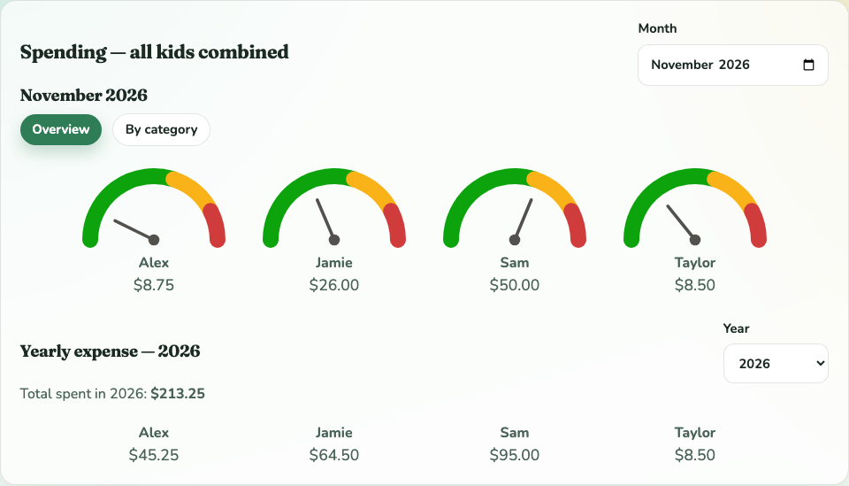
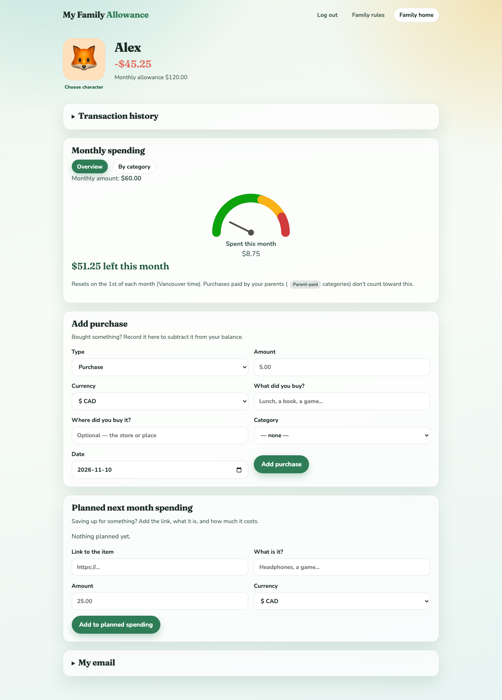
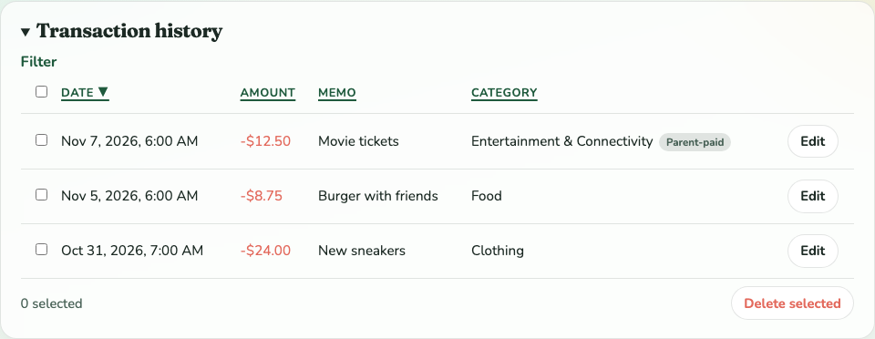

# My Family Allowance

Private family allowance tracking using Astro, Firebase Hosting, Cloud Functions,
and Firestore. Each parent and kid has their own reusable password.

## Screenshots

**Parent dashboard** — at a glance, see how much each kid has spent this month
against their limit, plus a running yearly total. Click a kid's gauge to jump to
their page.



**Kid's own page** — balance, a spending gauge for the month, and a quick form to
log a purchase or save up for something next month.



**Transaction history** — sortable, filterable, categorized, with purchases the
parents already covered (like sports gear or streaming) clearly marked so they
don't count against the kid's own budget.



*(Screenshots are from the local demo mode with sample data — no real family
information.)*

## Local demo

Create `.env` with `DEMO_MODE=true` and `SITE_URL=http://localhost:8888`, then run:

```sh
npm install
npm run dev -- --port 8888
```

Open http://localhost:8888. Local demo credentials:

| Role | Email / username | Password |
| --- | --- | --- |
| Parent | parent@example.com | parent-demo-2026 |
| Alex | alex-demo | alex-demo-2026 |
| Sam | sam-demo | sam-demo-2026 |

Demo records and password changes reset on server restart. Demo authentication and
fixture accounts cannot run in production. Roles share one browser cookie, so
signing in as a different family member switches that browser's account.

## Family accounts

- A private deployment token permits the first parent to choose a password at
  `/setup`. Only `OWNER_EMAIL` can initialize the family, and setup succeeds once.
  There is no public account registration or production default password.
- Parents sign in with email + password. An existing parent can create another
  parent account for the same family, with a separate password.
- Add a kid in admin, then expand **Kid sign-in & password** to see their generated
  username and set their password. Share those details privately.
- Kids see only their own balance/history and can record their own purchases.
  They can choose a character from **Change character** on their account; the
  saved avatar also appears in the parent dashboard and family overview.
- Parents can reset kids' passwords or disable kid sign-in. Parents change their
  own password by entering the current one. Password changes invalidate that
  account's existing sessions. Passwords cannot be displayed or recovered; a
  forgotten parent password requires an operator-assisted server-side reset.
- Passwords are case-sensitive and must contain 12–128 characters. Use a private,
  memorable phrase. Passwords are hashed on the server using a random salt and
  scrypt (N=131072, r=8, p=1); no plaintext or reversible password is stored.
  See [OWASP's password storage guidance](https://cheatsheetseries.owasp.org/cheatsheets/Password_Storage_Cheat_Sheet.html).

## Money tracking

Parents manage allowances, credits/deductions, and optional monthly spending
amounts. Blank means unlimited; zero warns for any purchase. Kids see monthly
spending and remaining amounts. All deductions count toward the calendar month in
America/Vancouver. Over-limit purchases require confirmation and can still be
recorded. Allowance credits run Sundays at 7am Vancouver time, with deterministic
transaction IDs preventing duplicates on retries for a scheduled date.

## Firebase deployment

Project: `<your-firebase-project-id>`. The private Firestore rules are deployed;
server deployment requires Firebase's **Blaze** plan, which can incur usage charges.
Google sign-in and Firebase Authentication setup are not required.

1. Sign in to the Firebase CLI with your own account and enable Blaze for the project.
2. Run `npm run firebase:prepare`, then copy `.env.firebase.example` to
   `.firebase-app/.env.<your-firebase-project-id>`. Keep `OWNER_EMAIL` set to the
   email that should initialize the family. The functions folder is generated and
   ignored by Git. The deployment hook preserves this environment file.
3. Set a random `SESSION_SECRET` of at least 32 characters using
   `firebase functions:secrets:set SESSION_SECRET --project <your-firebase-project-id>`.
4. Run `npm run setup:token`. It saves a private token file (permissions 0600) and
   prints the Firebase CLI command to store it as `INITIAL_SETUP_TOKEN`. Keep the
   token private: anyone with it and the owner email could initialize the family
   before you do. Never put it in a URL or commit it.
5. Deploy through the CLI:

```sh
npm run firebase:deploy
```

6. Open https://`<your-firebase-project-id>`.web.app/setup. Enter the owner email,
   private setup token, and your chosen reusable password. Subsequent sign-ins use
   `/parent-login`, without the setup token. Delete the local token file after setup.

The server uses its Firebase runtime identity to access Firestore; do not commit
service account keys. Existing Netlify/Postgres data and local demo data are not
uploaded automatically. Historical SQL migrations are retained as reference only.

## Security

Firestore denies all client SDK and REST access. Server routes verify family
ownership and roles; changing IDs in URLs cannot open another kid's account.
Firebase Hosting forwards the `__session` cookie. Both parent and kid sessions
are sealed, role-scoped, and checked against the current password version on every
request. They last seven days and use Secure/HttpOnly/SameSite=Lax cookies in
production. Private responses are not cached. Writes require the configured Origin;
trusted domains are listed in `astro.config.mjs` (update it for custom domains).

Login attempts are limited to 20 per 15-minute window for both the account and the
proxy-derived client address, with distributed counters in Firestore. Server
concurrency is capped at two requests per instance to bound scrypt memory use.
Public sign-in pages and static styling remain reachable; family data is private.

## Verification

```sh
npm run check
npm run firebase:prepare
firebase emulators:exec --only firestore --project demo-family-allowance "npm run test:security"
```

The Firestore emulator requires Java 21. Homebrew installs may need
`PATH=/opt/homebrew/opt/openjdk@21/bin:$PATH` before the emulator command.
Tests verify salted password hashing/reuse, protected one-time setup, additional
parent membership, kid isolation, resets/disabled logins, monthly purchase warnings,
login throttling, same-origin writes, private Firestore, and retry-safe allowance
credits. The integration test is explicitly skipped when no emulator is running.
